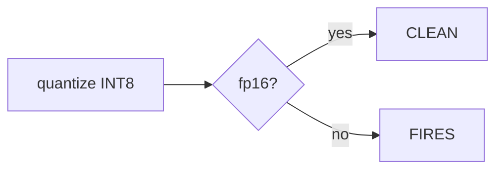

# MD Slide

A lightweight Markdown → slides tool that runs entirely in your browser. One self-contained HTML file (Mermaid embedded for diagrams), no installation, no build step, no network required. Works on Windows and macOS.

**To use it: download [`mdslide.html`](mdslide.html) and double-click it.** That's the whole setup.

## Features

- **Live preview** — edit Markdown on the left, see the 16:9 slide on the right instantly; the preview follows your cursor
- **5 built-in themes** — Clean, Dark, Academic, Gradient, Paper
- **PDF export** — one click, each slide becomes one page (via the browser's print engine)
- **Project folders** — open a local folder, browse its files in a sidebar, save and load `.md` files in place (Chrome/Edge)
- **Local images** — insert images from disk; they're copied into your project folder so references survive reloads
- **Mind maps** — draw one from an indented list, rendered as SVG
- **Flowcharts & diagrams** — fenced ```` ```mermaid ```` blocks (flowchart, sequence, state, …) rendered by an embedded copy of Mermaid, fully offline; diagrams auto-scale to fit the slide
- **Math** — `$inline$` and `$$display$$` TeX subset: fractions, roots, sub/superscripts, Greek letters, big operators, matrices
- **Citations & BibTeX** — cite with `[@key]`, load `.bib` files or embed one in the document, auto-generated reference list with overflow pagination
- **Multi-column layouts** — split any slide into columns
- **Nested lists, tables, code blocks with line numbers**, blockquotes, links
- **Autofit** — if a slide's body is taller than the page, it shrinks just enough to fit (PowerPoint-style, down to 40%); headings are exempt, so the same heading level always renders at the same size, and sparse slides never get enlarged
- **Section progress strip** — every slide except the cover (slide 1) shows a `title1 → title2 → title3` flow of the deck's section headings at the bottom, highlighting the current section (uses the most important heading level that occurs more than once); titles are never cut off: when the full flow gets too wide the strip first narrows to the current section and its neighbours (⋯ marks hidden sections), then scales as a whole if still needed; autofit reserves its row so the body never overlaps it. Pills are clickable and jump to that section (the ⋯ markers jump to the nearest hidden one)
- **Autosave** — content persists in `localStorage`; keyboard navigation with `←` `→`, save with `Ctrl/Cmd+S`

## Syntax

### Slides

Separate slides with `---` on its own line:

```markdown
# My Deck

A slide with only a big heading becomes a centered title slide.

---

## Second Slide

- Bullet points
  - Nested: indent by two spaces
    - Third level
```

### Columns

Split a slide with `|||` on its own line. For full control, open the column region with `|||(` — everything before it stays full-width — and optionally close it with `|||)` to return to full-width below:

```markdown
## Text Left, Image Right

This intro stays full-width.

|||(

Left column text, top-down.

|||


|||)

Full-width footnote under both columns.
```

Without `|||(`, the first `|||` starts the second column and only leading headings stay full-width (backward-compatible shorthand).

Each column starts at the **top** of the slide and flows downward, and columns are fully independent — a list in one column has nothing to do with a list in the next (numbering restarts, nesting is separate).

Modifiers on the separator line:

- `||| 2` — the next column is twice as wide (any number works, e.g. `||| 0.5` for a narrower one)
- `||| ~` — center that column vertically instead of top-aligning it (handy for an image beside a long list)
- `||| 2 ~` — both

More `|||` markers give you three or more columns.

> `|||` is custom syntax of this tool — standard Markdown has no column syntax, so other renderers will show it as plain text.

### Mind maps

A fenced `mindmap` block turns an indented list into a colored mind map:

````markdown
```mindmap
- Root
  - Branch A
    - Leaf 1
    - Leaf 2
  - Branch B
```
````

### Flowcharts (Mermaid)

A fenced `mermaid` block renders any [Mermaid](https://mermaid.js.org) diagram:

````markdown

````

Notes:

- Mermaid v11 (MIT license) is **embedded inside `mdslide.html`** — no network, no extra files, works fully offline. It sits inert at the end of the file and is only evaluated the first time a document actually uses a mermaid block, so decks without diagrams pay no startup cost. This is what grows the file to ~3.5 MB.
- Diagrams are capped at the slide width / 380 px height and participate in autofit, so they scale with the rest of the content; rendered SVG is cached so PDF export matches the preview.

### Math

Standard TeX-style delimiters — `$...$` inline, `$$...$$` display:

```markdown
Inline: $E = mc^2$, $\alpha + \beta \le \gamma$

$$ \mathrm{MSE} = \frac{1}{N} \sum_{i=1}^{N} (y_i - \hat{y}_i)^2 $$

$$ A = \begin{bmatrix} 1 & 2 \\ 3 & 4 \end{bmatrix} $$
```

Supported subset: `^` `_` sub/superscripts, `\frac`, `\sqrt`, Greek letters, ~90 common symbols (`\le`, `\infty`, `\in`, `\to`, `\partial`, …), big operators (`\sum` `\prod` `\int`), functions (`\sin` `\log` `\lim`, …), accents (`\bar` `\hat` `\vec`), `\mathbf` `\mathrm` `\text`, and matrix environments (`matrix`, `pmatrix`, `bmatrix`, `vmatrix`, `Vmatrix`, `cases`). Multi-line alignment environments are supported too: `\begin{align}` (and `aligned`, `gather`, `split`, `eqnarray`) with `&` anchors and `\\` line breaks; `\label`/`\notag` are ignored gracefully. Rendered with pure HTML/CSS — no external libraries.

Dollar amounts like `$5 and $10` are left alone (math requires non-space characters directly inside the delimiters).

### Citations

Cite with Pandoc-style keys, and put `[references]` on its own line where the bibliography should appear:

```markdown
Transformers changed everything [@vaswani2017], and pre-training
made them practical [@vaswani2017; @devlin2019].

---

## References

[references]
```

Three citation styles, switchable in the toolbar:

- **Numeric (by order)** — `[1]`, `[1, 2]`, references numbered in citation order (IEEE-style)
- **Numeric (A–Z)** — same in-text look, but references are sorted alphabetically first and numbered `1..N` in that order
- **Author–Year** — `(Vaswani et al., 2017)`, references sorted alphabetically (APA-style)

Reference lists that don't fit on one slide **paginate automatically** across as many slides as needed, with continuous numbering.

Load BibTeX entries three ways:

1. **Project folder** — every `.bib` file in the folder is parsed automatically
2. **Import button** — also accepts `.bib` files
3. **Embedded** — put entries in a fenced `bibtex` block inside the document itself (renders as nothing, so a single `.md` file can carry its own bibliography):

````markdown
```bibtex
@inproceedings{vaswani2017,
  author    = {Ashish Vaswani and Noam Shazeer},
  title     = {Attention Is All You Need},
  booktitle = {NeurIPS},
  year      = {2017}
}
```
````

Unknown keys render as red `[?key]` so typos are easy to spot.

## PDF export

Click **⬇ Download PDF**, then choose *Save as PDF* in the print dialog. Each slide is exactly one 960×540 px page with backgrounds preserved.

Tips:

- Chrome or Edge give the best results (they honor the custom page size)
- If you see a URL/date in the margins, uncheck *Headers and footers* in the print dialog
- `Ctrl/Cmd+P` works too

## Project folders, saving, and images

Click **📁 Project** and pick a folder (Chrome/Edge; uses the [File System Access API](https://developer.mozilla.org/en-US/docs/Web/API/File_System_Access_API)):

- The sidebar lists the folder tree — click a 📝 `.md` to open it, a 🖼 image to insert a reference, a 📚 `.bib` to (re)load it
- **💾 Save** (`Ctrl/Cmd+S`) writes back to the opened file; with no file open it creates one in the folder
- **🖼 Image** copies the picked image into the project folder and inserts `` at the cursor
- Reference images in Markdown by filename or relative path — they resolve against the project folder
- **Size images** with a `|` suffix in the alt text (Obsidian-style):
  - `` — width 300 px, height keeps the aspect ratio
  - `` — half the content width
  - `` — exact box (may change the aspect ratio)
  - `` — height only, width keeps the aspect ratio
- A paragraph containing just one image centers it; unsized images are capped at 320 px tall, explicit sizes override the cap

On Safari/Firefox the folder features are unavailable; **Import** (file picker) and **Save** (download) still work.

## Browser support

| | Chrome / Edge | Safari / Firefox |
|---|---|---|
| Editing, preview, themes, math, mind maps, citations | ✅ | ✅ |
| PDF page size honored | ✅ | ⚠️ falls back to paper size |
| Project folder / save in place | ✅ | ❌ (import/download fallback) |

## Development

Everything lives in a single `mdslide.html` — vanilla JS, no build. Open it, edit it, refresh. The file contains, in order: theme CSS, print CSS, a small TeX renderer, a Markdown parser, a BibTeX parser, the mind-map layout engine, and the app wiring.

## Disclaimer

This software is provided **"as is"**, without warranty of any kind, express or implied, including but not limited to the warranties of merchantability, fitness for a particular purpose, and non-infringement. In no event shall the authors or copyright holders be liable for any claim, damages, data loss, or other liability — whether in an action of contract, tort, or otherwise — arising from, out of, or in connection with the software or the use of or other dealings in the software.

You are solely responsible for the content you create, store, and export with this tool. Content is saved to your browser's local storage and to files you choose on your own machine; nothing is uploaded anywhere. Always keep your own backups of important documents and verify exported files before relying on them.

## License

[Apache 2.0](LICENSE) — see also [NOTICE](NOTICE).

The tool embeds one third-party component: **Mermaid v11** (MIT license, © Knut Sveidqvist and contributors; see [NOTICE](NOTICE) for the full license text). Otherwise it bundles no third-party code, fonts, or assets; the Markdown parser, math renderer, and mind-map layout are original implementations. Apache 2.0 grants you the right to use, modify, and redistribute this software, including commercially, provided you keep the copyright and license notices. It does not grant rights to any trademark.
